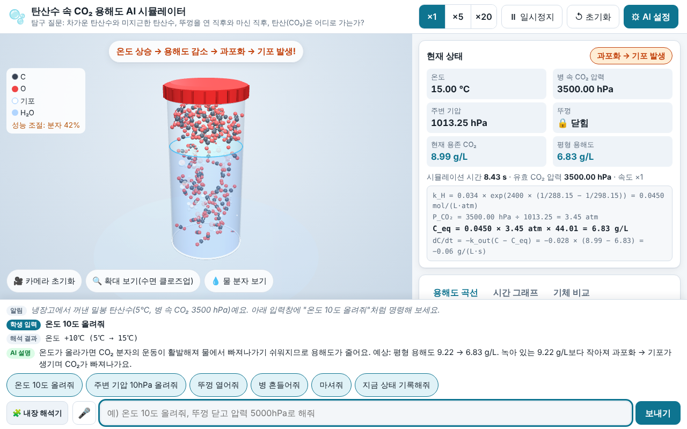
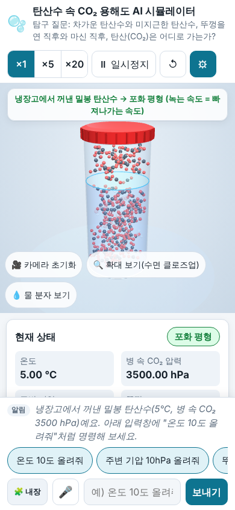

# 🫧 탄산수 속 CO₂ 용해도 AI 시뮬레이터

고등학교 화학 수업용 웹 시뮬레이터입니다. 학생이 한국어 문장으로 명령하면 탄산수의 온도·압력·뚜껑 상태가 바뀌고,
3D 분자 모형·기포·그래프로 **기체의 용해도**가 어떻게 달라지는지 바로 볼 수 있습니다.

> **탐구 질문** — 차가운 탄산수와 미지근한 탄산수, 뚜껑을 연 직후와 마신 직후, 탄산(CO₂)은 어디로 가는가?

| 데스크톱 | 모바일 |
|---|---|
|  |  |

## 핵심 개념

- 기체의 용해도는 **온도가 높을수록 감소**합니다.
- 기체의 용해도는 그 기체의 **부분압력에 비례**합니다(헨리 법칙).
- 녹아 있는 양이 평형 용해도보다 많으면 **과포화** 상태이고, 이때 **기포**가 생깁니다.

## 화면 구성

- **3D 뷰**: 유리병, 물, 헤드스페이스, 뚜껑, O=C=O 볼-앤-스틱 CO₂ 분자, H–O–H(104.5°) 물 분자, 기포.
  마우스 드래그(회전)·휠(확대), 터치 드래그·핀치 확대를 지원합니다. `카메라 초기화`, `확대 보기(수면 클로즈업)`, `물 분자 보기` 버튼이 있습니다.
- **상태 카드**: 온도, 병 속 CO₂ 압력, 주변 기압, 뚜껑, 용존 CO₂, 평형 용해도, 상태 배지(과포화·포화 평형·불포화)와 숫자를 대입한 계산식.
- **그래프 3종**: 용해도 곡선(현재 점이 곡선 쪽으로 움직임), 최근 60초 시간 그래프, CO₂·O₂·N₂ 기체 비교.
- **수동 조작**: 온도·병 속 CO₂ 압력·주변 기압 슬라이더, 뚜껑·흔들기·마시기 버튼.
- **실험 기록**: 표, CSV 저장(엑셀에서 한글이 깨지지 않도록 UTF-8 BOM 포함), 표 복사.
- **AI 명령 입력창**(하단 고정): 예시 칩, 🎤 음성 입력(지원 브라우저만), 현재 해석 모드 배지.

## 사용법 — 예시 명령

입력창에 쓰고 Enter를 누르거나, 예시 칩을 누르세요. 쉼표·`그리고`·`~고`로 이어진 명령은 순서대로 실행됩니다.

| 명령 | 일어나는 일 |
|---|---|
| `온도 10도 올려줘` | 온도 +10℃ → 용해도 감소 → 과포화 → 기포 |
| `온도 30도로 맞춰줘` / `300K로 해줘` / `50℉로` | 온도 설정(단위 자동 변환) |
| `온도 열 도 내려줘` | 한글 수사도 읽음 → 온도 −10℃ |
| `압력 5000hPa로 해줘` / `2기압으로 맞춰` / `압력 100kPa 올려` | 뚜껑이 닫혀 있으면 병 속 CO₂ 압력, 열려 있으면 주변 기압 |
| `주변 기압 10hPa 올려줘` | 항상 주변 기압 변경 |
| `뚜껑 열어줘` / `뚜껑 닫아줘` | 유효 CO₂ 압력 3500 hPa → 0.41 hPa |
| `병 흔들어줘` / `5초 흔들어` | 3초(또는 지정 시간) 동안 기포 방출 속도 ×6 |
| `마셔줘` | 뚜껑 열고 2초 동안 37℃로 → 입 안에서 방출될 CO₂ 양과 탄산감 게이지 |
| `뚜껑 닫고 압력 5000hPa로 해줘` | 복합 명령: 닫기 → 가압 → 불포화 → CO₂가 녹아 들어감 |
| `지금 상태 기록해줘` | 실험 기록 표에 한 줄 추가 |
| `속도 20배` / `빠르게` / `멈춰` / `다시 시작` / `처음으로` | 시간 조절·초기화 |
| `수온이 오르면 물고기에게 어떤 일이?` | 질문하면 설명만 해 줌 |

정도 표현: **조금** = 5℃ 또는 100 hPa, **많이** = 20℃ 또는 500 hPa, 표현이 없으면 10℃ 또는 200 hPa. `2배`, `절반`도 이해합니다.
값의 범위(온도 0~80℃, 병 속 CO₂ 압력 0~6000 hPa, 주변 기압 300~2000 hPa)를 넘으면 잘라 내고 경고를 보여 줍니다.

## AI 모드 설정법 (선택)

기본은 **🧩 내장 해석기**(규칙 기반)이며, 키가 없어도·오프라인이어도 항상 동작합니다.
대형 언어 모델로 더 자유로운 문장을 해석하려면:

1. 상단의 **⚙ AI 설정**을 누릅니다.
2. **AI 모드 사용**을 체크하고 제공자를 고릅니다.
   - Anthropic Claude (기본 모델 `claude-sonnet-4-6`)
   - OpenAI (기본 모델 `gpt-4o-mini`)
   - Google Gemini (기본 모델 `gemini-2.5-flash`)
   - OpenAI 호환 사용자 지정 URL (예: `http://localhost:11434/v1` — Ollama, LM Studio 등)
3. 모델명을 확인·수정하고 **API 키**를 입력한 뒤 **저장**합니다. 입력창 옆 배지가 `🤖 AI 모드(모델명)`으로 바뀝니다.

- API 키는 **이 탭의 메모리 변수에만** 보관됩니다. 브라우저 저장공간·화면·콘솔에 남기지 않고, 새로 고치면 사라집니다.
- LLM 응답이 JSON 형식이 아니거나 검증에 실패하거나, 네트워크 오류가 나거나, **8초 안에 오지 않으면** 자동으로 내장 해석기가 처리합니다.
- Anthropic은 키가 비어 있으면 키 헤더 없이 한 번 시도합니다(claude.ai 아티팩트 미리보기에서 키 없이 쓰기 위한 동작). claude.ai에서 열면 AI 모드가 자동으로 켜집니다.
- 학생 기기에서 키를 쓸 때는 사용량 한도를 걸어 둔 키를 쓰세요. 이 저장소에는 어떤 키도 들어 있지 않습니다.

## 과학 모델 (src/core.js)

- 헨리 상수: `k_H(T) = k_H298 × exp(C × (1/T − 1/298.15))` (T: K)
  - CO₂ 0.034 mol/(L·atm), 2400 K · O₂ 0.0013, 1500 K · N₂ 0.00061, 1300 K
- 평형 용해도(g/L) = `k_H(T) × P_CO₂(atm) × 44.01`
- 유효 CO₂ 압력: 뚜껑 닫힘 → 병 속 CO₂ 압력, 뚜껑 열림 → 주변 기압 × 0.0004
- 시간 변화
  - 과포화: `dC/dt = −k_out(C − C_eq)`, `k_out = 0.02 × (1 + (T−5)/25)` /s, 흔들기 중 ×6, 감소분의 80 %는 기포·20 %는 수면 확산
  - 불포화: `dC/dt = +0.008 × (C_eq − C)` /s
- 온도·압력 변경은 1.5초에 걸쳐 부드럽게 바뀝니다(마시기는 2초).
- 초기 상태: 5℃, 병 속 CO₂ 3500 hPa, 주변 기압 1013.25 hPa, 뚜껑 닫힘, 용존 CO₂ = 평형값(9.22 g/L).

## 빌드·테스트

Node.js 18 이상이 필요합니다.

```bash
npm install      # three@0.128.0 설치 (빌드할 때만 필요)
npm run build    # src/ → docs/index.html 한 파일로 인라인
npm test         # node --test tests/ (과학 모델·해석기·빌드 결과물 검사)
```

- `src/index.html`: 화면 템플릿(`<!-- INLINE:CSS -->` 등 자리표시)
- `src/style.css`: 스타일(라이트·다크 테마)
- `src/core.js`: 과학 모델과 내장 자연어 해석기(DOM·THREE·fetch를 쓰지 않는 순수 로직)
- `src/app.js`: UI, Three.js 3D 장면, Canvas 그래프, LLM 호출, 채팅 기록
- `scripts/build.mjs`: 위 파일과 `three.min.js`(라이선스 주석 보존)를 `docs/index.html`에 인라인
- `tests/core.test.mjs`: 자동 테스트

`docs/index.html`은 외부 요청 없이 파일만 더블클릭해서 열어도 동작합니다(LLM 호출만 예외).

## GitHub Pages 배포

1. 이 저장소를 GitHub에 올립니다(`docs/index.html`이 커밋되어 있어야 합니다).
2. 저장소의 **Settings → Pages**로 갑니다.
3. **Build and deployment → Source**를 `Deploy from a branch`로 두고, Branch를 **`main`**, 폴더를 **`/docs`**로 고른 뒤 **Save**를 누릅니다.
4. 1~2분 뒤 `https://<사용자명>.github.io/<저장소명>/` 주소로 접속합니다.

코드를 고친 뒤에는 `npm run build`로 `docs/index.html`을 다시 만들어 함께 커밋하세요.

## 알려진 한계(단순화 가정)

- 뚜껑이 닫힌 병은 **외부에서 압력을 조절하는 가압 용기**로 단순화했습니다. 실제 병에서는 CO₂가 빠져나오면 헤드스페이스 압력이 올라가지만, 이 모델에서는 병 속 CO₂ 압력을 사용자가 정한 값으로 유지합니다.
- 뚜껑을 열면 병 속 CO₂ 압력도 대기 수준(주변 기압 × 0.0004)으로 떨어지며, 다시 닫아도 자동으로 가압되지 않습니다.
- 헨리 상수의 온도 의존은 단순 지수식이며, 염·당 같은 용질 효과, CO₂의 탄산 이온화(H₂CO₃/HCO₃⁻), 물의 증기압은 무시합니다.
- 기포 방출은 1차 속도식 하나로 표현했습니다. 핵 생성·기포 크기·표면적의 영향은 3D 장면의 연출일 뿐 계산에 쓰이지 않습니다.
- "마시기"는 병 전체가 입 안 조건(37℃, 뚜껑 열림)이 된다고 가정한 사고 실험입니다.
- 3D 분자 수는 용존량에 비례한 **표현용 숫자**이며 실제 분자 수가 아닙니다. 분자 크기도 실제보다 매우 크게 그렸습니다.
- 내장 해석기는 정규식·키워드 사전 기반이라 복잡한 문장(조건문, 부정문 등)은 잘못 이해할 수 있습니다. 이때는 예시처럼 짧게 말하거나 AI 모드를 쓰세요.
- 음성 입력은 Web Speech API를 지원하는 브라우저(Chrome, Edge 등)에서만 보입니다.

## 라이선스

three.js(MIT, © 2010-2021 Three.js Authors)를 포함합니다. 라이선스 주석은 빌드 결과물에 그대로 보존됩니다.
